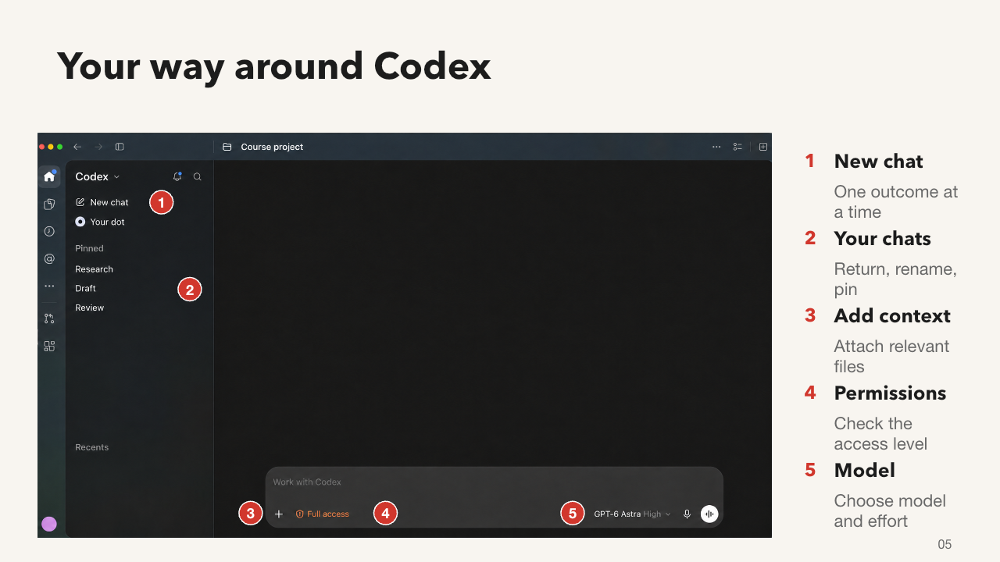
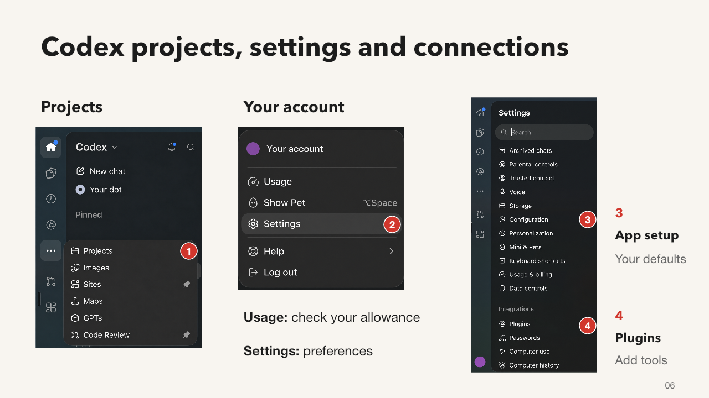

# Finding your way around Codex

- Start a new chat for a distinct outcome
- Return to existing chats in the sidebar
- Use the plus control to attach relevant files
- Check the permission setting before asking for changes
- Use the model control to select an available model and effort

Open the dots menu to find Projects. Create or select your project, then use Edit project > Add folder when you need to attach a folder. The follow-on folder dialog is not shown here.

Open the account avatar to find Usage and Settings. Settings contains Configuration, keyboard shortcuts and Plugins. Use Plugins to find integrations and capabilities. Open a saved file from a chat to inspect the output in the app.

These are privacy-edited teaching screenshots. Generic labels replace personal details. Full access in the example is not a requirement: use the permission baseline approved for your work. Menus and model availability can vary by app version and account.

Official references:
- https://learn.chatgpt.com/docs/projects
- https://learn.chatgpt.com/docs/models
- https://learn.chatgpt.com/docs/app
